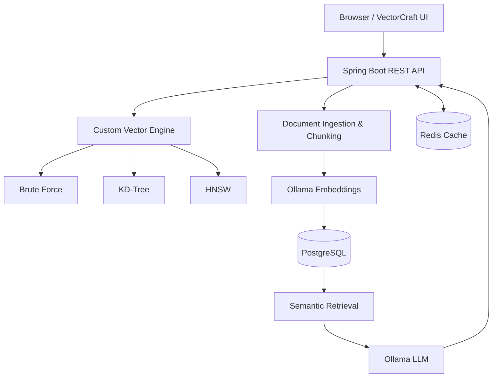

<div align="center">

# VectorCraft

<p align="center">
  
  
  
  
</p>

### Explore vectors. Understand retrieval. Build with RAG.

A Java-based semantic search and Retrieval-Augmented Generation (RAG) playground that combines a custom vector-search engine with locally hosted language models.

<p>
  <strong>Java 21</strong> · <strong>Spring Boot</strong> · <strong>PostgreSQL</strong> · <strong>Redis</strong> · <strong>Ollama</strong> · <strong>Docker Compose</strong>
</p>

</div>

---

## Overview

VectorCraft is an interactive learning and experimentation platform for understanding how embeddings, vector search, document retrieval, and RAG work together.

It includes a browser-based interface with beginner-friendly AI concepts and an AI Lab for exploring vectors, indexing documents, searching semantically, and asking questions grounded in retrieved context.

> Local-first AI: Ollama runs the embedding and generation models locally. Your application does not require a paid model API to run the core workflow.

---

## Why VectorCraft?

VectorCraft is designed for developers, students, and AI enthusiasts who want to see the internals of modern AI retrieval systems without hiding everything behind a managed service.

- Learn how embeddings are generated and used
- Compare vector algorithms like brute force, KD-Tree, and HNSW
- See how retrieval quality changes with chunking and thresholds
- Experiment with local RAG pipelines using Ollama
- Inspect evidence before trusting a generated answer

---

## Features

- Interactive AI learning workspace covering LLMs, tokens, embeddings, vector search, RAG, hallucinations, and prompt design
- Custom vector-search engine with Brute Force, KD-Tree, and HNSW implementations
- Semantic document search by chunking documents, generating embeddings, and matching by similarity
- RAG question answering that retrieves relevant document context before answering
- Evidence inspection to review retrieved chunks, distance scores, and answer grounding
- Configurable retrieval tuning for chunk size, overlap, result count, and relevance threshold
- Redis response cache with configurable TTL
- PostgreSQL persistence with Flyway migrations
- Vector visualization and benchmarking to compare search approaches
- Docker Compose setup for running the full stack in one command

---

## Architecture



### Request flow for RAG

1. A user submits a question through the VectorCraft interface.
2. Ollama generates an embedding for the question.
3. The application retrieves candidate document chunks using vector similarity search.
4. The configured relevance policy determines which chunks are used as evidence.
5. The selected context and question are sent to the configured Ollama generation model.
6. The response, model details, and retrieved context are returned to the UI. Redis can cache the response.

> Visualization note: the 2D embedding plot is an exploratory projection, not a calibrated measure of semantic similarity. A plotted distance should not be interpreted as an answer-confidence metric.

---

## Technology stack

| Layer | Technologies |
| --- | --- |
| Language / Runtime | Java 21 |
| Backend | Spring Boot 4 |
| API Documentation | Springdoc OpenAPI / Swagger UI |
| Vector Search | Custom Java implementations: Brute Force, KD-Tree, HNSW |
| Persistence | PostgreSQL 17, Spring Data JPA |
| Schema Migrations | Flyway |
| Cache | Redis 7 |
| Embeddings & Generation | Ollama |
| Default Embedding Model | `nomic-embed-text` |
| Default Generation Model | `llama3.2` |
| Frontend | HTML, CSS, JavaScript |
| Containers | Docker, Docker Compose |
| Testing | JUnit / Spring Boot Test / Testcontainers |

---

## Getting started

### Prerequisites

- Docker Desktop with Docker Compose
- Git (optional, for cloning)
- Enough disk space and memory for PostgreSQL, Redis, the Java application, and Ollama models

Docker downloads the images and model files on first startup. The Ollama models can require several gigabytes of disk space. If your development machine is low on space, use a remote VM or a remote machine.

### 1. Clone the repository

```bash
git clone https://github.com/YOUR_USERNAME/vectorcraft.git
cd vectorcraft
```

Replace `YOUR_USERNAME` with your GitHub username. If you already have the project locally, run the following commands from the project root instead.

### 2. Configure environment variables

Create a `.env` file beside `docker-compose.yml`:

```dotenv
POSTGRES_DB=yourownai
POSTGRES_USER=yourownai
POSTGRES_PASSWORD=replace_with_a_strong_password
REDIS_PASSWORD=replace_with_a_different_strong_password
```

Use your own strong passwords. Never commit `.env` or real credentials to GitHub.

The Compose file binds services to loopback addresses by default. This is intended for local development and avoids exposing PostgreSQL, Redis, and Ollama to the local network.

### 3. Start the complete stack

From the directory containing `docker-compose.yml`:

```bash
docker compose up -d --build
```

Check the services:

```bash
docker compose ps
docker compose logs -f app
```

### 4. Download the Ollama models

The first run requires the models to be downloaded into the persistent Ollama volume:

```bash
docker exec -it your-own-ai-ollama ollama pull nomic-embed-text
docker exec -it your-own-ai-ollama ollama pull llama3.2
```

Confirm the models are available:

```bash
docker exec -it your-own-ai-ollama ollama list
```

Wait for model downloads to finish before testing document ingestion or RAG question answering.

### 5. Open VectorCraft

| Resource | Local URL |
| --- | --- |
| Web interface | http://localhost:8080/ |
| API status | http://localhost:8080/api/v1/status |
| Actuator health | http://localhost:8080/actuator/health |
| Swagger UI | http://localhost:8080/swagger-ui.html |

If a port is already in use, configure the corresponding host-port variable in `.env` or your shell before starting Compose.

---

## Run tests

To run the test suite on your machine (requires Java 21 and Maven):

```bash
mvn clean verify
```

The Docker image is built with a multi-stage Dockerfile in `docker/Dockerfile`. Compose uses that file to compile the application and package the executable JAR.

---

## API overview

Base path: `/api/v1`

| Method | Endpoint | Purpose |
| --- | --- | --- |
| `GET` | `/status` | Application and vector-store summary |
| `POST` | `/vectors` | Insert a demo vector |
| `GET` | `/vectors` | List demo vectors |
| `GET` | `/vectors/stats` | Vector-store statistics |
| `POST` | `/vectors/search` | Search demo vectors |
| `DELETE` | `/vectors/{id}` | Delete a demo vector |
| `GET` | `/vectors/benchmark` | Run the vector-search benchmark |
| `POST` | `/documents` | Add a document for indexing |
| `GET` | `/documents` | List documents |
| `POST` | `/documents/search` | Semantic document search |
| `GET` | `/documents/vectors` | Get document-chunk vectors for visualization |
| `DELETE` | `/documents/{id}` | Delete a document |
| `POST` | `/rag/ask` | Ask a question using retrieved document context |

### Example: add a document

```http
POST /api/v1/documents
Content-Type: application/json
```

```json
{
  "title": "Spring Boot Notes",
  "text": "Spring Boot helps developers build standalone, production-ready Java applications."
}
```

### Example: ask a RAG question

```http
POST /api/v1/rag/ask
Content-Type: application/json
```

```json
{
  "question": "What does Spring Boot help developers build?",
  "k": 5
}
```

For request/response schemas, use Swagger UI when the application is running.

---

## Configuration

The following application properties can be configured through environment variables:

| Variable | Default | Purpose |
| --- | --- | --- |
| `DB_URL` | `jdbc:postgresql://localhost:55432/yourownai` | JDBC URL |
| `DB_USERNAME` | `postgres` | PostgreSQL username |
| `DB_PASSWORD` | `postgres` | PostgreSQL password |
| `REDIS_HOST` | `localhost` | Redis hostname |
| `REDIS_PORT` | `6379` | Redis port |
| `REDIS_PASSWORD` | empty | Redis password |
| `OLLAMA_BASE_URL` | `http://localhost:11434` | Ollama endpoint |
| `OLLAMA_EMBEDDING_MODEL` | `nomic-embed-text` | Embedding model |
| `OLLAMA_GENERATION_MODEL` | `llama3.2` | Generation model |
| `OLLAMA_TIMEOUT_SECONDS` | `120` | Ollama request timeout |
| `RAG_CHUNK_SIZE` | `250` | Chunking size |
| `RAG_CHUNK_OVERLAP` | `30` | Chunk overlap |
| `RAG_DEFAULT_K` | `5` | Default number of retrieval candidates |
| `RAG_RELEVANCE_THRESHOLD` | `0.35` | Retrieval relevance threshold |
| `RAG_CACHE_TTL_SECONDS` | `3600` | RAG cache TTL |
| `HNSW_M` | `16` | HNSW graph connectivity parameter |
| `HNSW_EF_CONSTRUCTION` | `100` | HNSW construction search parameter |
| `HNSW_EF_SEARCH` | `50` | HNSW query search parameter |

Compose-specific variables include `POSTGRES_DB`, `POSTGRES_USER`, `POSTGRES_PASSWORD`, `REDIS_PASSWORD`, and host binding/port variables such as `APP_HOST_PORT`, `POSTGRES_HOST_PORT`, `REDIS_HOST_PORT`, and `OLLAMA_HOST_PORT`.

The defaults are for local development. Set strong credentials and private network bindings for any server deployment. The relevance threshold is model- and corpus-dependent; calibrate it against your own documents and questions.

---

## Project structure

```text
your-own-ai-java/
├── docker/
│   └── Dockerfile
├── src/
│   ├── main/
│   │   ├── java/com/yourownai/
│   │   │   ├── config/
│   │   │   ├── controller/
│   │   │   ├── dto/
│   │   │   ├── exception/
│   │   │   ├── model/
│   │   │   ├── repository/
│   │   │   ├── service/
│   │   │   └── vectordb/
│   │   └── resources/
│   │       ├── db/migration/
│   │       ├── static/index.html
│   │       └── application.yml
│   └── test/java/com/yourownai/
├── docker-compose.yml
├── pom.xml
└── README.md
```

---

## Engineering notes and limitations

- The custom vector engine is implemented in Java to make search algorithms inspectable and educational.
- PostgreSQL persists documents and chunks; the in-memory HNSW index is reconstructed from stored data during application startup.
- Demo vectors and document embeddings follow different flows in the application; do not assume every displayed demo vector is persisted.
- HNSW is an approximate nearest-neighbor algorithm. Benchmark recall and latency against Brute Force on representative data before making performance claims.
- Embedding model changes can change vector dimensions and semantic behavior. Re-index documents when changing the embedding model.
- The RAG relevance threshold needs evaluation on your own documents and questions.
- A public deployment needs appropriate API access controls, request-size limits, rate limiting, HTTPS, secrets management, backups, and monitoring before it is suitable for untrusted users.

---

## Screenshots

Add screenshots or a short GIF here after capturing the current UI:

```text
docs/
└── screenshots/
    ├── learning-workspace.png
    ├── vector-lab.png
    └── rag-evidence.png
```

For example, once the files are committed, you can embed them with:

```md

```

---

## Roadmap

- [ ] Add screenshots and a short demo walkthrough
- [ ] Add authentication and API rate limiting for public deployment
- [ ] Expand integration tests for persistence and retrieval edge cases
- [ ] Add repeatable benchmark datasets and recall/latency reporting
- [ ] Publish a live demo with HTTPS and deployment documentation

---

## Contributing

Issues and pull requests are welcome. For meaningful changes, include tests and document any configuration changes.

---

## License

No license has been specified yet. Add a `LICENSE` file before allowing others to reuse, modify, or redistribute this project. Until then, all rights remain with the copyright holder by default.

<p align="center">
  <sub>Built with ❤️ for learning, experimentation, and local-first AI.</sub>
</p>
